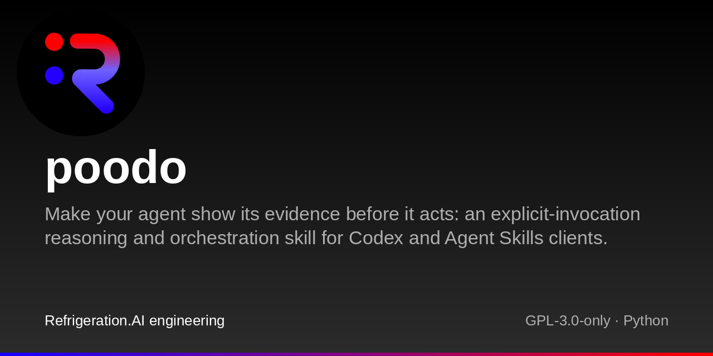
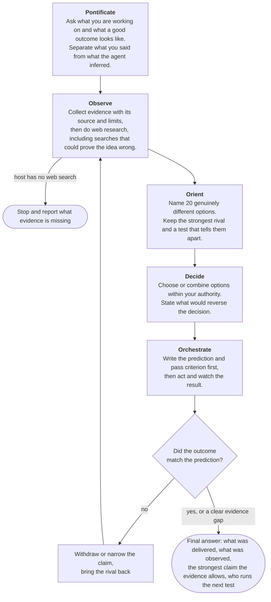

# POODO

An agent skill for Codex and other Agent Skills clients that makes your coding agent show its evidence before it acts.

[](LICENSE)

POODO is a folder of written instructions (a *skill*) that you clone into your coding agent's skills folder. Codex, OpenAI's coding agent, reads skills from `SKILL.md` files, and so do other agents that support the Agent Skills format. When you call it (in Codex, by typing `$poodo` in your request), the agent separates what it saw from what it assumes, keeps a serious rival explanation alive, writes down what should happen before it acts, and refuses to call something a success until the outcome you actually wanted has been observed. It is deliberately thorough and slow, so it is for decisions where being wrong costs more than waiting.

## What changes

Here is one case from the repository's evaluation set: a release passed every check, but a real user test shows nothing changed. The two answers below are illustrations written by hand to show the difference, not recorded model output.

> A release has matching source and deployed hashes, passes schema checks, and has a valid receipt. A permitted end-to-end user test reports that none of the promised behavior changed. Assess status and identify the next step. Do not modify anything.

**Without POODO**, a typical answer trusts the checks:

> The release is verified. Source and deployed hashes match, schema checks pass and the receipt is valid, so the deployed code is the code we reviewed. Because the artifacts are identical, the end-to-end result most likely comes from the environment, such as a CDN or browser cache still serving the old build. The fix is in place. Next step: purge the cache and re-run the user test.

**With POODO**, the answer leads with the correction:

> **The improvement claim is withdrawn.** The user test was the success criterion, and it failed.
>
> - Still true: the hashes and schema checks pass. They show the right files were deployed in the right shape. They do not show the behavior changed.
> - Cause: unknown. Two credible explanations remain. One is a defect in the change. The other is that requests reach a different runtime than the one that was checked.
> - Next observation: compare the failing request's destination and runtime identity with the checked deployment, then repeat the user flow with the same inputs. This needs read-only access only.
> - State: delivered to production; outcome failed according to the user test, not yet observed by the agent. The strongest claim the evidence supports is that the checks do not show the intended effect.

Where the answers come from: the prompt is case `structural-pass-outcome-fail` in [evals/manifest.yaml](evals/manifest.yaml). Both answers were written by hand for this README. The unguided answer makes the case's two forbidden moves: it explains away the runtime result because hashes match, and it calls the outcome fixed. The guided answer meets the case's three required points and follows the contradiction format in [references/output-patterns.md](references/output-patterns.md) and the handoff in [examples/deployment-contradiction.md](examples/deployment-contradiction.md). No model was run for this README. The repository has no recorded trial runs yet, so this shows the target behavior, not a measured result. To compare on your own agent, send the same prompt with and without `$poodo` and score both answers with the [rubric](evals/rubric.md).

## Why use it

Coding agents often stop at the first thing that looks like proof. A green build, a matching hash or a confident summary from an earlier session gets reported as "fixed", and nobody checks the thing the user asked for. POODO is a written procedure that tells the agent to keep those apart. Use it when being wrong is expensive: architecture choices, hard bugs, disputed evidence, and work that has to survive several sessions or handoffs.

Do not use it for quick questions or routine edits. Every call runs the whole loop, including web research and 20 distinct options before choosing. The agent scales the depth of evidence and testing to the stakes, but the loop is still slow and uses a lot of context; no timing has been measured. POODO itself is just files with no service behind it; a run costs whatever your agent's model and web search normally cost, only more of it. The answer you read stays short; the working notes can be long.

## How it works

POODO is named after its five stages: Pontificate (pin down the problem with you), Observe (collect evidence), Orient (lay out the options), Decide (choose) and Orchestrate (act and check). They run in order, and each has a gate the agent must pass before moving on. If the result contradicts the prediction, the agent goes back to Observe with the new evidence.



The agent follows [SKILL.md](SKILL.md), which states 14 rules and the loop. It loads one of 15 reference files from [references/](references/) when a stage needs it. For work that spans sessions, the agent writes a handoff file that a small checker can verify; see [Handoffs between sessions](docs/guides/explanation/how-it-works.md#handoffs-between-sessions).

## Install and try

POODO needs the whole directory, not just `SKILL.md`, because `SKILL.md` links to files in `references/` and `assets/`. Full use also needs a host with web search. Without it, the agent still frames the problem and gathers evidence, then stops before listing options and tells you what is missing. In the Codex CLI, `codex --search` turns on live web search.

### Codex

```sh
mkdir -p "$HOME/.agents/skills"
git clone https://github.com/Akilleez-QA/poodo.git "$HOME/.agents/skills/poodo"
```

Restart Codex if the skill does not appear. Call it by putting `$poodo` in your message. Codex does not start POODO on its own, because [agents/openai.yaml](agents/openai.yaml) sets `allow_implicit_invocation: false`. `git clone` refuses to overwrite a non-empty folder, so an existing copy is safe.

Checked on 2026-11-08 with Codex CLI 0.167.0, without a model call: Codex finds the skill in this folder ([how](docs/guides/tutorials/getting-started.md#how-the-install-was-checked)).

### Claude Code

```sh
mkdir -p "$HOME/.claude/skills"
git clone https://github.com/Akilleez-QA/poodo.git "$HOME/.claude/skills/poodo"
```

Call it with `/poodo` followed by your request, for example `/poodo assess this: ...`. Claude Code reads personal skills from `~/.claude/skills/<name>/SKILL.md` and runs one directly with `/<name>`, according to its [skills documentation](https://code.claude.com/docs/en/skills). Unlike Codex, Claude Code may also load POODO on its own when a request looks relevant, because this repository's `SKILL.md` does not set `disable-model-invocation: true`. To allow only `/poodo`, add that line to the front matter of your copy ([how this was checked](docs/guides/tutorials/getting-started.md#how-the-install-was-checked)).

### Other Agent Skills clients

For another client, look up where that client reads skills from, clone the same repository into that folder, and call the skill the way that client calls skills. Other clients may use different folders and invocation syntax, and may ignore `agents/openai.yaml`. `SKILL.md` itself says to use POODO only when explicitly invoked. See the [skill host interface](docs/icd/icd-skill-host.md).

### First request

The quickest try needs no project. Paste this into Codex (in Claude Code, start with `/poodo` instead of `Use $poodo to`), then compare the answer with the two in [What changes](#what-changes):

```text
Use $poodo to assess this: A release has matching source and deployed hashes,
passes schema checks, and has a valid receipt. A permitted end-to-end user test
reports that none of the promised behavior changed. Assess status and identify
the next step. Do not modify anything.
```

For real work, give the agent a concrete problem, the outcome you want and what it may touch; [Getting started](docs/guides/tutorials/getting-started.md#first-use) has a sample prompt. Expect a short exchange about your goal first, then evidence, options, and a decision or a clear statement of what evidence is missing. It runs every stage even on a small question, so expect it to take longer than a normal request. The [examples](examples/README.md) show what each step looks like.

## What's inside

| Path | What it is |
| --- | --- |
| [`SKILL.md`](SKILL.md) | The skill: 14 rules, the loop, when to load each reference |
| [`references/`](references/) | One file per stage or topic: evidence rules, contradictions, handoffs, output formats |
| [`agents/openai.yaml`](agents/openai.yaml) | Codex display name and the explicit-only setting |
| [`scripts/`](scripts/) | `validate_skill.py` and `check_capsule.py`: structure checks, no model needed ([how to run](docs/guides/how-to/evaluation.md#check-the-files)) |
| [`evals/`](evals/) | 14 behavioral test cases, 8 Mega Observe probes, a scoring rubric, and 13 checker tests |
| [`examples/`](examples/README.md) | Four hand-written scenarios, not measured runs |
| [`assets/`](assets/) | Charter template for Mega Observe |
| [`tools/`](tools/) | Documentation trace check and release-document generator |
| [`docs/`](docs/README.md) | Guides and engineering records |

## Status and limitations

- Method version 3.1, capsule schema `POODO_CONTINUATION/3.0`. No release is tagged; install from `main` and note the commit.
- **No measured effect yet.** The 14 behavioral cases and 8 probes are designs. None has been run and graded, and there is no baseline comparison.
- The checkers test structure only. `validate_skill.py` has no tests of its failure paths, and several capsule-checker rules are untested. The [verification matrix](docs/verification/verification-matrix.md#untested-requirement-gaps) lists every gap.
- The skill grants no permissions and adds no tools. It relies on the host for web search, subagents and permissions. Do not use its output as the only basis for a safety, engineering or regulated decision. See [Limitations](docs/guides/explanation/limitations.md).
- An optional, much larger research mode, [Mega Observe](references/mega-observe.md), runs only when you ask for it by name. It can cost hundreds of dollars in model use. The agent must agree a scope and spending limit with you first; the repository ships no spending cap of its own.

## Learn more

- [Getting started](docs/guides/tutorials/getting-started.md): install, first use, updates and removal
- [How POODO works](docs/guides/explanation/how-it-works.md): the stages, the loop in pseudocode, and where each step is specified
- [Examples](examples/README.md): a deployment contradiction, an architecture decision, a handoff, a Mega Observe plan
- [Evaluation](docs/guides/how-to/evaluation.md): run the checks and design a behavioral study
- [Documentation index](docs/README.md)

## Related projects

POODO is part of a small family of repositories maintained together. [Cstack](https://github.com/Akilleez-QA/cstack) keeps a pinned copy of POODO's method files ([interface](docs/icd/icd-cstack.md)); POODO does not depend on it or on any other family repository.

Other family repositories: [endoforge](https://github.com/Akilleez-QA/endoforge) (runs coding agents with checks and receipts) and the Foundations [engine](https://github.com/Akilleez-QA/foundation-engine), [math](https://github.com/Akilleez-QA/foundation-math), [film](https://github.com/Akilleez-QA/foundation-film), [refrigeration](https://github.com/Akilleez-QA/foundation-refrigeration), [robotics](https://github.com/Akilleez-QA/foundation-robotics) and [template](https://github.com/Akilleez-QA/foundation-template).

## Contributing and security

Start with [CONTRIBUTING.md](CONTRIBUTING.md). Recorded failure cases, independently graded trials, clearer examples and checker fixes are the most useful contributions. A change to the method should explain the problem and bring evidence for its effect. Report vulnerabilities through [SECURITY.md](SECURITY.md); for other questions see [SUPPORT.md](SUPPORT.md). Participation follows the [Code of conduct](CODE_OF_CONDUCT.md).

## Engineering records

POODO keeps a requirements, design, interface and verification record set, organized after NASA software documentation guidance. Classification: self-assessed Class E analog under NPR 7150.2D, not safety-critical. This is not a NASA compliance determination or certification; see the [software management plan](docs/plan/software-management-plan.md#1-software-classification-self-assessed). The full list of control documents is in the [documentation index](docs/README.md#engineering-records).

## License

GNU General Public License v3.0 only (GPL-3.0-only). If you want to use POODO in a product or service under different terms, commercial licenses are available from Refrigeration.AI. Contact craig@nh3.biz.
