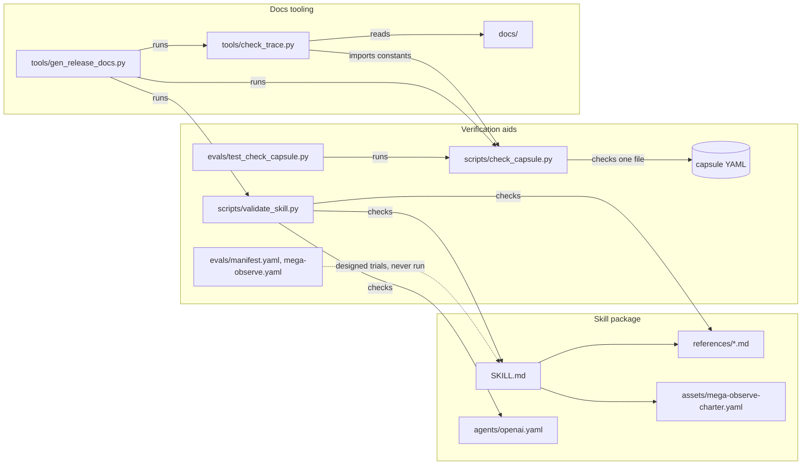
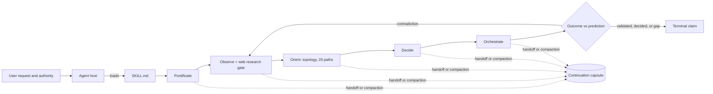

# POODO software design description

| Field | Value |
|---|---|
| Document ID | POODO-SDD |
| Version | 2.0 |
| Status | Baselined |
| Owner | Akilleez-QA |
| Date | 2026-11-08 |
| Baseline commit | `b969150462c5fde83bbec9358ad17aa1d3663ec2` |
| Applies to | poodo main at baseline commit (method 3.1) |
| Classification | Self-assessed Class E analog; not safety-critical (see [SMP §1](../plan/software-management-plan.md#1-software-classification-self-assessed)) |

> Organized after [NPR 7150.2D](https://nodis3.gsfc.nasa.gov/displayAll.cfm?Internal_ID=N_PR_7150_002D_&page_name=all), [NASA-STD-8739.8B](https://standards.nasa.gov/standard/nasa/nasa-std-87398) and the [NASA Software Engineering Handbook](https://swehb.nasa.gov/display/SWEHBVD/7.18+-+Documentation+Guidance) documentation guidance. This is not a NASA compliance determination or certification. The software classification is a self-assessed analog (Class E, not safety-critical); no NASA authority, independent verification and validation, or hazard analysis is asserted. The document describes the implementation inspected at the baseline commit.

## 1. Purpose and design boundary

This document explains how POODO meets its [requirements](../requirements/requirements.md), for a reader about to change it. It expands [How POODO works](../guides/explanation/how-it-works.md).

POODO is an instruction package that an agent host executes. Its entry point is [SKILL.md](../../SKILL.md), metadata version 3.1. The host supplies the model, tools, permissions, web search, subagents and native goals. The skill cannot create those capabilities or increase the user's authority. Two Python scripts check package and capsule structure. They do not run the reasoning loop and cannot show that it works.

## 2. Design decisions and trade-offs

These summarize decisions visible in the source. No ADRs exist.

| Decision | Alternatives the source rules out | Rationale | Requirements |
|---|---|---|---|
| Ship the method as Markdown instructions plus linked references | Code that drives the agent | Any Agent Skills host can load it; the host keeps control of tools and permissions | REQ-PO-001, REQ-PO-019 |
| Explicit invocation only | Implicit activation on matching prompts | The full loop is costly and wrong for routine work | REQ-PO-001, REQ-PO-024 |
| Mandatory web research before Orient; stop if unavailable | Proceed on prior model knowledge | Broadens the frame; an honest stop beats a silent shortcut | REQ-PO-010 |
| Exactly 20 distinct paths before convergence | Rank the first plausible options | Forces divergence before commitment | REQ-PO-011 |
| Precommit predictions before acting | Judge outcomes after the fact | Stops outcome-dependent changes to the test | REQ-PO-006, REQ-PO-007 |
| Continuation capsule is metadata, not evidence | Treat a summary as fresh evidence | Handoffs must not manufacture evidence | REQ-PO-009 |
| Validators check structure only and say so in their output | A validator that grades reasoning | A self-authored check cannot corroborate behavior | REQ-PO-028, REQ-PO-037 |
| Mega Observe is optional, explicit and budget-gated | Make the expensive mode default | Cost and padding risk | REQ-PO-017, REQ-PO-018 |
| One pinned dependency (PyYAML) | Schema libraries | Small install surface | REQ-PO-044 |

## 3. Architecture overview

Static view (what is in the repository):

Runtime view (what happens when an agent runs the skill):

## 4. Components

| Component | Path | Responsibility | Inputs → outputs | Requirements |
|---|---|---|---|---|
| Entry contract | `SKILL.md` | Invocation scope, 14 invariants, loop order, routing, terminal claim contract, scaling and stopping | User request → agent obligations | REQ-PO-001, REQ-PO-002, REQ-PO-003, REQ-PO-004, REQ-PO-008, REQ-PO-016, REQ-PO-020, REQ-PO-021 |
| Host metadata | `agents/openai.yaml` | Codex display name, short description, default prompt, explicit-only policy | Host discovery → invocation policy | REQ-PO-001 |
| Phase guidance | `references/*.md` | Detailed rules for each phase, fan-out, topology, goals, method selection, output patterns | Phase entry → phase records | REQ-PO-005, REQ-PO-006, REQ-PO-007, REQ-PO-010, REQ-PO-011, REQ-PO-012, REQ-PO-013, REQ-PO-014, REQ-PO-015, REQ-PO-019 |
| Continuity contract | `references/continuity-and-ledger.md` | Capsule schema POODO_CONTINUATION/3.0, lineage, rehydration rules | State at a boundary → capsule | REQ-PO-009 |
| Optional research charter | `references/mega-observe.md`, `assets/mega-observe-charter.yaml` | Mega Observe protocol and the charter to fill before a run | Explicit request → charter, budget gates | REQ-PO-017, REQ-PO-018 |
| Package validator | `scripts/validate_skill.py` | Required files, front matter, host metadata, reference links, placeholders, schema literals, execute bits | Checkout → exit 0 or 1 with messages | REQ-PO-022, REQ-PO-023, REQ-PO-024, REQ-PO-025, REQ-PO-026, REQ-PO-027, REQ-PO-028, REQ-PO-044 |
| Capsule checker | `scripts/check_capsule.py` | Structure and referential integrity of one capsule file | YAML file → exit 0, 1 or 2 with messages | REQ-PO-009, REQ-PO-029, REQ-PO-030, REQ-PO-031, REQ-PO-032, REQ-PO-033, REQ-PO-034, REQ-PO-035, REQ-PO-036, REQ-PO-037, REQ-PO-038, REQ-PO-039, REQ-PO-040, REQ-PO-041, REQ-PO-042, REQ-PO-043, REQ-PO-044 |
| Checker regression tests | `evals/test_check_capsule.py`, `evals/fixtures/` | Subprocess tests of the capsule checker | Fixtures → pass/fail | infrastructure (verifies the capsule checker) |
| Behavioral evaluation material | `evals/manifest.yaml`, `evals/mega-observe.yaml`, `evals/protocol.md`, `evals/rubric.md`, `evals/run-record.template.yaml` | 14 base cases, 8 Mega Observe probes, grading rules, run-record template | Frozen configuration → graded trials (none recorded) | infrastructure (verification material for REQ-PO-001 to REQ-PO-021) |
| Examples | `examples/` | Synthetic illustrations, not measured runs | — | infrastructure (documentation) |
| Docs tooling | `tools/` | Trace and link check; generator for the VDD and STR | Docs and test tree → pass/fail; generated reports | infrastructure |
| CI | `.github/workflows/checks.yml` | Runs every check on Python 3.10 and 3.14 on each push and PR | Commit → check status | infrastructure |

## 5. Execution concept

**Skill.** There is no process. The agent reads SKILL.md, then reads references when a routing condition holds. Control flow is the loop in §3: Pontificate, Observe, Orient, Decide, Orchestrate, then a comparison of outcome with prediction. A contradiction sends the agent back to Observe with a new prediction ID. The loop stops at a validated outcome in a named scope, a justified decision with a next action, or a precise evidence or authority gap (REQ-PO-016, REQ-PO-021). Before each phase boundary the agent considers a bounded subagent spike and reconciles its results before recording the gate (REQ-PO-013). Concurrency, if any, is subagents run by the host.

**Validators.** Each is a single-threaded command that reads files, prints, and exits. `validate_skill.py` collects every error before exiting, so one run reports all failures. `check_capsule.py` loads YAML with a loader that rejects duplicate and non-string keys, then runs `validate()`, which also collects all errors. Neither writes files, opens a network connection or starts a subprocess. The regression tests start the checker as a subprocess with `sys.executable`.

**Docs tooling.** `check_trace.py` reads the SRS, verification matrix, SDD, data dictionary, CI workflow, test files and all Markdown, and imports `check_capsule.py` to read its field constants. `gen_release_docs.py` refuses a dirty tracked tree, runs the five suites with each `--python` interpreter, calls the trace check, optionally queries `gh`, and writes two files.

## 6. Interfaces

| Interface | Document |
|---|---|
| Skill package as loaded by an Agent Skills or Codex host | [icd-skill-host.md](../icd/icd-skill-host.md) |
| Capsule checker command and capsule file format | [icd-capsule-checker.md](../icd/icd-capsule-checker.md) |
| Cstack's byte-pinned snapshot and its `poodo_core` | [icd-cstack.md](../icd/icd-cstack.md) |

Internal interface: `check_trace.py` imports `check_capsule.py` and reads `REQUIRED`, `OPTIONAL` and the six value sets. Renaming those constants breaks the trace check.

## 7. Failure handling and containment

- Both validators fail closed: any error gives a non-zero exit, and a malformed value is reported, not raised. The regression tests assert that no traceback appears.
- `check_capsule.py` separates load failure (exit 2) from structural failure (exit 1).
- An oversize capsule fails unless it declares `capsule_overflow`; the checker never truncates.
- The skill fails closed on capability: no web research means stop before Orient (REQ-PO-010); missing goal tools mean no simulated goal state (REQ-PO-015).
- Nothing is retried automatically.

## 8. Resource use

The validators read a few small files and hold one capsule in memory. The capsule ceiling defaults to about 1,800 tokens, estimated as (characters + 3) // 4. No resource figure has been measured. The skill's costs (latency, context, web queries, subagents, Mega Observe spend) fall on the host; the repository measures none of them.

## 9. Quality attributes

- Maintainability: one entry file, one reference per concern, two small scripts, one pinned dependency (REQ-PO-044).
- Testability: the capsule checker is a pure `validate(data, raw_text, ceiling)` function behind a thin CLI; tests drive the CLI. The package validator has no tests (gaps UG-28 to UG-33).
- Portability: CI runs on Python 3.10 and 3.14 on `ubuntu-latest`. Other operating systems are untested.
- Security: no network, no writes, `yaml.SafeLoader` subclass, no `eval`. See the [SMP §7](../plan/software-management-plan.md#7-security-privacy-and-secure-coding).
- Usability: every pass message states what it does not establish.

## 10. Assumptions and limitations

- The full loop has research and exploration costs and is outside the stated scope for routine questions.
- Behavioral improvement is unmeasured. A package check, a capsule check or a synthetic example does not show sound reasoning or a successful outcome.
- The capsule checker cannot inspect the world behind evidence locators or compare sibling capsules.
- Host features (web search, subagents, `/goal`) vary by host and version; the skill assumes nothing beyond what the host exposes.

## Change history

| Version | Date | Commit | Change | Reviewed in |
|---|---|---|---|---|
| 1.0 | 2026-10-30 | squashed into `36bfe78` | Context, components, control flow and boundaries | PR #12 |
| 2.0 | 2026-11-08 | `b969150` | Family format; decisions table; Mermaid static and runtime views; components with requirement allocation; execution, failure, resource and quality sections; docs tooling | this PR |
